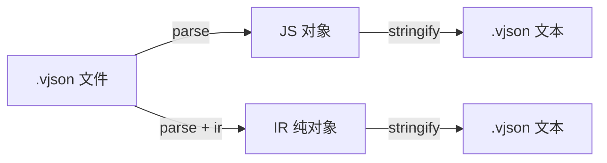

# VarJson

把分散的配置片段**组装成一份可在程序里直接使用的 JS 对象**。

- **不是 DSL**：无函数、运算、分支、循环。
- **出口是入口文件的 `var`**：其它作用域只是零件。
- **对外只暴露两个 API**：`parse` / `stringify`。
- **每次调用独立会话**，不串全局缓存。



| 项 | 说明 |
|----|------|
| 实现 | TypeScript |
| 署名 | **Deepl-ysp** |
| vscode插件 | VJSON Language (未发布测试中) |

---

## 安装与运行

将源码置于项目中后：

```ts
import { parse, stringify } from "./index.ts";
```

```bash
node --experimental-strip-types test/test.ts
```

---

## API（仅此两个）

### `parse(path, options?)`

`.vjson` > **JS 对象**（默认） / 带 IR / JSON 字符串。

```ts
// 程序内直接用
const cfg = await parse("./app.vjson");
console.log(cfg.host);

// 泛型标注返回类型（语言本身无类型系统；T 只作用于 TS）
const cfg2 = await parse<AppConfig>("./app.vjson");

// 可选 IR（可 JSON 序列化，供 stringify 还原源码）
const { data, ir } = await parse("./app.vjson", { ir: true });

// 需要字符串时
const text = await parse("./app.vjson", { json: true });
```

**关于 `<T>`**

- 未传 `T` 时默认为 `Record<string, unknown>`。
- 源文件或结构较大（经验：**超过约 1500 字符**）时请**显式写 `parse<YourType>(...)`**，不要依赖自动推导。

每次 `parse` 新建会话，结果为深拷贝后的普通对象。

### `stringify(input)`

**JS 对象** 或 **IR** > `.vjson` 源码字符串。

```ts
// 从 IR 还原（保留 import、& 引用）
const src1 = stringify(ir);

// 从普通对象生成（仅 var 字面量，无引用）
const src2 = stringify({ host: "localhost", port: 8080 });
// =>
// var = {
//   host = "localhost",
//   port = 8080
// };
```

---

## 最小例子

```vjson
tops = {
  host = "localhost",
  port = 8080
};

var = {
  host = &tops.host,
  port = &tops.port
};
```

```ts
const cfg = await parse("./data.vjson");
// { host: "localhost", port: 8080 }
```

---

## 目录

```text
index.ts         # 唯一公开 API：parse / stringify
common.ts        # 内部类型与工具
parse.ts         # 内部：词法 / IR / 加载
stringify.ts     # 内部：求值
decompile.ts     # 内部：IR > 文本
test/            # 测试与 fixtures
docs/            # 文档
```

---

## 测试产物 `target/`（运行测试后生成）

| 文件 | 含义 |
|------|------|
| `main.data.json` | parse 结果 |
| `main.ir.json` | IR |
| `main.from-ir.vjson` | stringify(ir) |
| `main.from-obj.vjson` | stringify(对象) |
| `main.roundtrip.json` | 往返后再 parse |
| `errors/*.txt` | 错误样例 |

---

## 文档

- [教程 TUTORIAL.md](./TUTORIAL.md)
- [索引 INDEX.md](./INDEX.md)

