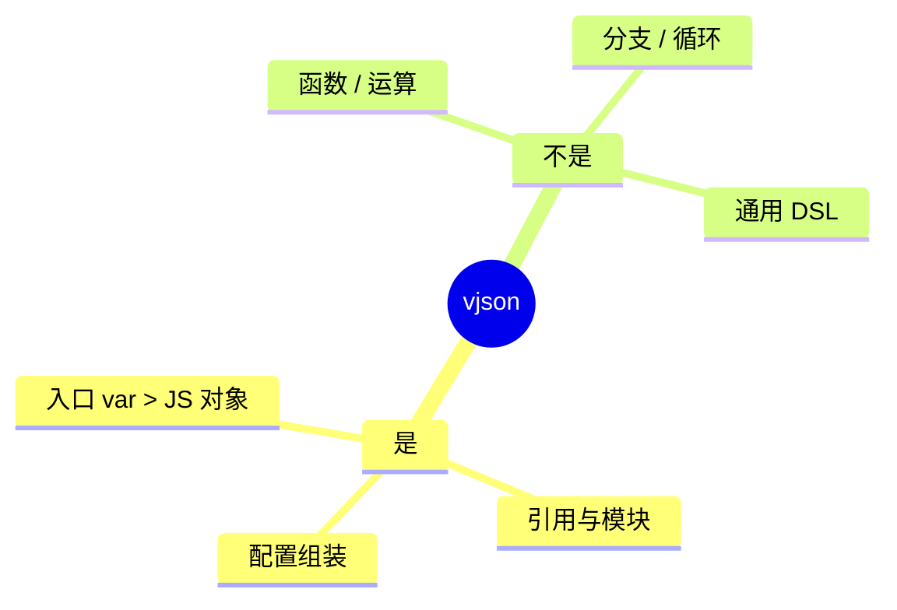
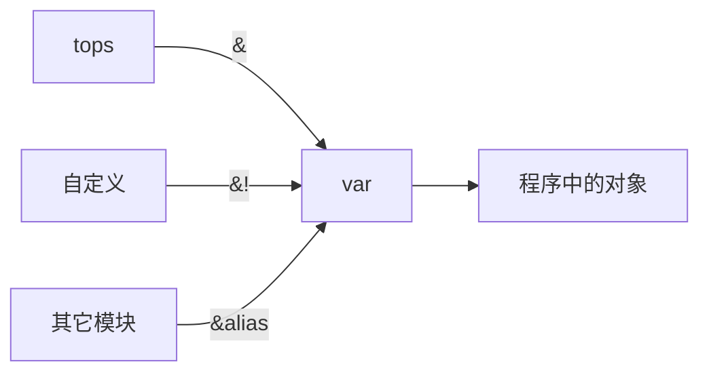
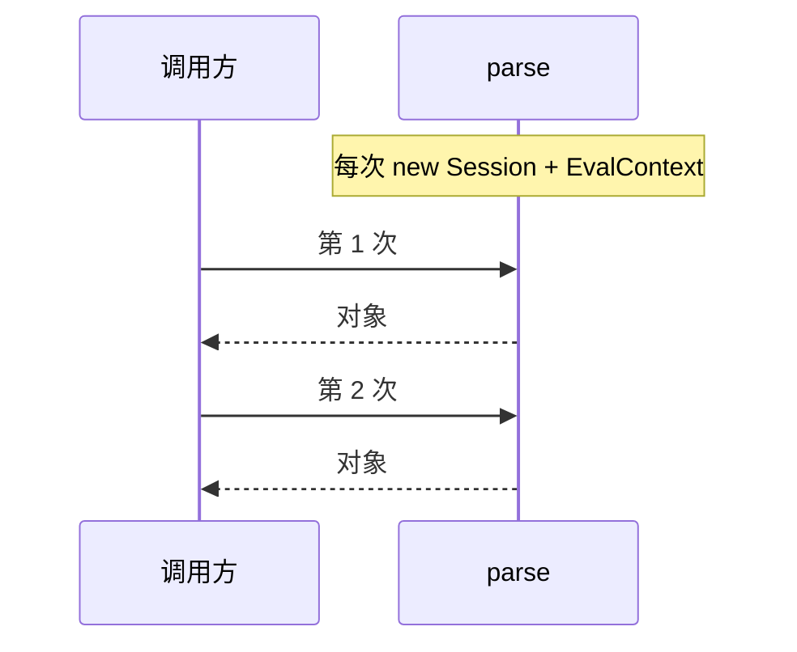

# VarJson 教程

面向「在程序里 `parse` 出 JS 对象」的用法说明。  
公开 API **只有** `parse` 与 `stringify`。

署名：**Deepl-ysp**

---

## 1. 定位



语言**没有类型系统**；TypeScript 可用 `parse<T>()` 给返回值标注类型。

---

## 2. 两个 API

### parse

```ts
import { parse } from "./index.ts";

const obj = await parse("./app.vjson");           // JS 对象
const typed = await parse<MyCfg>("./app.vjson"); // 显式 T
const { data, ir } = await parse("./app.vjson", { ir: true });
const jsonText = await parse("./app.vjson", { json: true });
```

| 参数 | 返回 |
|------|------|
| （默认） | `T`（默认 `Record<string, unknown>`） |
| `{ ir: true }` | `{ data: T, ir }` |
| `{ json: true }` | `string` |

未传 `T` 时按宽类型处理。源内容较长（约 **>1500 字符**）请显式传 `T`，避免无意义的推导。

每次调用新建会话；返回值为深拷贝对象，可直接 `obj.x`。

### stringify

```ts
import { stringify } from "./index.ts";

stringify(ir);   // IR > 完整 vjson（含 & / import）
stringify(obj);  // 普通对象 > var = { ... };
```

---

## 3. 语法速查

- 作用域：`tops`（不输出）、`var`（输出）、自定义  
- 同作用域裸名；跨作用域 `&tops.x`；顶级自定义 `&!xxx.a`；跨文件 `&alias.k`  
- 仅字面量与路径引用，无运算符  
- `import "./x.vjson" as alias;`



---

## 4. 调用隔离



---

## 5. 练习

1. `parse` 读入入口，打印若干字段。  
2. `parse(..., { ir: true })` > `stringify(ir)` > 再 `parse`。  
3. `stringify({ a: 1 })` 得到的源码再 `parse`。  
4. 显式 `parse<YourType>`。  

---

## 6. 误区

- 把 vjson 当脚本语言  
- 裸名跨作用域  
- 第二次调用指望全局缓存（本实现无此行为）  
- 大文件不写 `T` 却指望精细推导  
